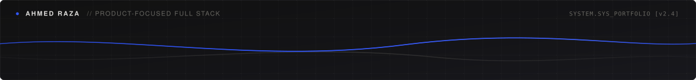

  

 

<table>
  <tr>
    <td width="200" align="center" valign="middle">
      
    </td>
    <td valign="middle">
      <h1>Ahmed Raza</h1>
      
<strong>Product-focused Full Stack Developer</strong>

      
Full Stack Developer who enjoys building real-world web applications, practical business tools, and AI-powered automation. I work across the stack — from clean, responsive interfaces to backend APIs, database architecture, and automated testing.

      

        <a href="https://github.com/AhmedRaza186"><strong>GitHub</strong></a> &nbsp;·&nbsp;
        <a href="https://www.linkedin.com/in/ahmed-raza-mun/"><strong>LinkedIn</strong></a> &nbsp;·&nbsp;
        <a href="https://www.instagram.com/the_ahmed__raza/"><strong>Instagram</strong></a> &nbsp;·&nbsp;
        <a href="mailto:ahmedrazamun@gmail.com"><strong>Email</strong></a>
      

    </td>
  </tr>
</table>

 

## 🧩 Selected Work

<table>
<tr>
<td width="50%" valign="top">

### 🤖 [Auto-QA](https://github.com/AhmedRaza186/Auto-QA)
**AI-Powered Test Automation Agent**

Analyzes GitHub repositories and generates automated Playwright tests, helping developers catch issues without manually writing every test case.

`TypeScript` · `Next.js` · `Drizzle` · `PostgreSQL` · `Gemini` · `Playwright` · `GitHub OAuth`

→ [Repository](https://github.com/AhmedRaza186/Auto-QA) &nbsp;·&nbsp; [Live Demo](https://auto-qa-rouge.vercel.app/)

</td>
<td width="50%" valign="top">

### 🌍 TradeSift
**AI-Powered Trade Compliance Platform**

A product focused on simplifying trade compliance workflows through AI-assisted analysis and automation.

`React` · `JavaScript` · `Tailwind CSS` · `REST APIs`

</td>
</tr>
<tr>
<td width="50%" valign="top">

### 🏠 [GoldenKey Estates](https://github.com/AhmedRaza186/GoldenKey-Estates)
**Real-Estate Web Platform**

A modern property-focused web application designed around clear information architecture, responsive UI, and smooth user interaction.

`React` · `JavaScript` · `Node.js` · `MongoDB`

</td>
<td width="50%" valign="top">

### 📄 [Doc Flow](https://github.com/AhmedRaza186/DocFlow)
**Collaborative Document Editor**

A Google Docs-inspired application with document management, authentication, and a structured backend architecture.

`React` · `TypeScript` · `Express` · `Prisma` · `PostgreSQL`

</td>
</tr>
</table>

 

## 🛠️ Technical Capabilities

| Area | Core Technologies & Tools |
| :--- | :--- |
| **Frontend** | React, Next.js, TypeScript, JavaScript (ES6+), Tailwind CSS, HTML5, CSS3 |
| **Backend & APIs** | Node.js, Express.js, REST APIs, Authentication (OAuth, JWT) |
| **Databases & ORMs** | PostgreSQL, MongoDB, Prisma, Drizzle ORM, Mongoose |
| **Testing & Tooling** | Playwright (E2E), Git, GitHub, Vercel, Supabase, Firebase |

 

## 🧠 Engineering Approach

- **Product-First Thinking:** Caring about how users interact with a system, how it scales, and the concrete operational problem it solves.
- **Full-Stack Ownership:** Connecting responsive, accessible user interfaces with reliable backend services, database schemas, and authentication.
- **Continuous Improvement:** *Build → Debug → Learn → Improve* — catching issues early with automated testing and maintaining predictable codebases.

 

## 📈 Activity & Contributions

<picture>
  <source media="(prefers-color-scheme: dark)" srcset="https://cdn.jsdelivr.net/gh/AhmedRaza186/AhmedRaza186@output/github-contribution-grid-snake-dark.svg">
  <source media="(prefers-color-scheme: light)" srcset="https://cdn.jsdelivr.net/gh/AhmedRaza186/AhmedRaza186@output/github-contribution-grid-snake.svg">
  
</picture>

 

---

## 🌐 Get In Touch

I am always open to discussing full-stack projects, practical tooling, and software engineering opportunities.

- **Email:** [ahmedrazamun@gmail.com](mailto:ahmedrazamun@gmail.com)
- **LinkedIn:** [linkedin.com/in/ahmed-raza-mun](https://www.linkedin.com/in/ahmed-raza-mun/)
- **GitHub:** [github.com/AhmedRaza186](https://github.com/AhmedRaza186)
- **Instagram:** [@the_ahmed__raza](https://www.instagram.com/the_ahmed__raza/)

 

  

